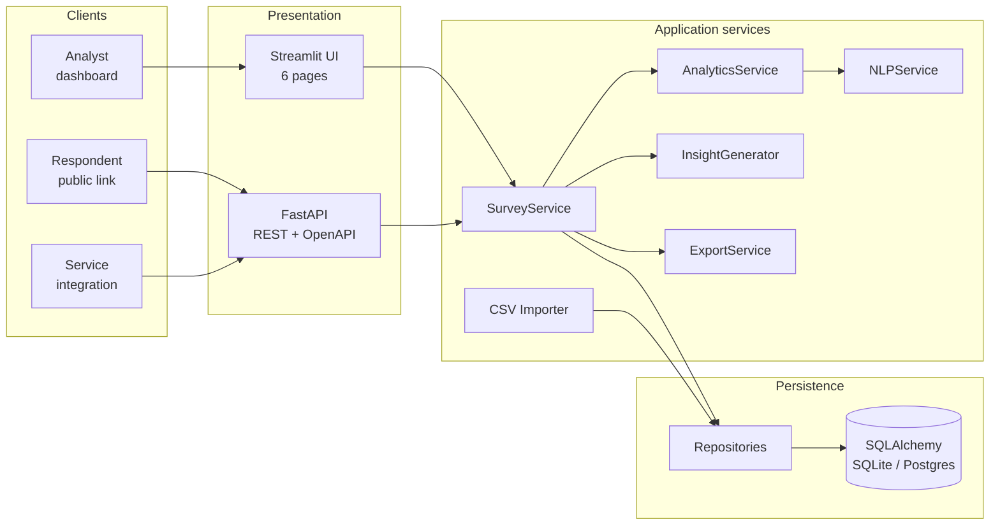

# Smart Survey Tool

**AI-powered survey collection, analytics and insight platform.**

Build multi-question surveys, collect validated responses through a REST API or an
embeddable form, and turn free-text answers into NPS, CSAT, sentiment, topics and
prioritised recommendations — without sending your data to a third-party LLM.

[](https://github.com/Harishwaran18/Smart-Survey-Tool/actions/workflows/ci.yml)
[](https://www.python.org/)
[](LICENSE)
[](https://docs.astral.sh/ruff/)

---

## Table of contents

- [Why this project](#why-this-project)
- [Features](#features)
- [Architecture](#architecture)
- [Quickstart](#quickstart)
- [Configuration](#configuration)
- [REST API](#rest-api)
- [Command line](#command-line)
- [Dashboard](#dashboard)
- [Migrating legacy data](#migrating-legacy-data)
- [Testing](#testing)
- [Project layout](#project-layout)
- [Design decisions](#design-decisions)
- [Deployment](#deployment)
- [Roadmap](#roadmap)
- [License](#license)

---

## Why this project

Most survey tools either stop at a spreadsheet export or lock your data inside a
paid SaaS. This project gives you the whole pipeline — authoring, validated
collection, statistics and qualitative analysis — as a small, well-tested,
self-hostable codebase.

Everything runs offline. The NLP layer uses TF-IDF, K-Means and TextRank, so you
get reproducible results with no API keys, no GPU and no data leaving your machine.

## Features

### Survey authoring
- Seven question types: short text, long text, rating, NPS (0–10), single choice,
  multiple choice and yes/no.
- Type-aware validation at submission time (scale bounds, option membership,
  required questions, payload size).
- Draft → published → closed lifecycle with publish guards.
- Human-readable slugs plus unique-slug generation for shareable links.

### Collection
- Public submission endpoint that needs no authentication.
- Streamlit form that renders any survey definition dynamically.
- Per-response metadata: duration, source and free-form respondent attributes.

### Analytics
- **NPS** with promoters / passives / detractors breakdown.
- **CSAT** using the top-2-box definition on any rating scale.
- Distributions, mean, median and standard deviation per numeric question.
- Choice distribution with counts and percentages, multi-choice aware.
- 30-day response timeline and week-over-week trend.
- Completion rate and average completion time.

### AI insights (offline)
- Lexicon sentiment with negation scope and intensifier handling.
- Topic discovery via TF-IDF + K-Means with silhouette-based `k` selection.
- Extractive TextRank summaries and TF-IDF keyword extraction.
- A rule engine that turns metrics into ranked findings with a recommended action.
- Optional HuggingFace transformer backend for higher accuracy.

### Platform
- FastAPI REST API with OpenAPI docs and constant-time API-key auth.
- Streamlit dashboard with a custom design system and Plotly charts.
- CSV / Excel / JSON export, in wide or tidy (long) format.
- SQLite by default, PostgreSQL via a single environment variable.
- Structured logging, typed configuration, Docker image, CI pipeline and 106 tests.

## Architecture



The dependency rule is strict: **presentation → services → repositories → models**.
Services never touch HTTP or Streamlit, and only repositories touch SQLAlchemy
sessions. That is why the whole domain is testable without a browser or a server.

## Quickstart

### Local

```bash
git clone https://github.com/Harishwaran18/Smart-Survey-Tool.git
cd Smart-Survey-Tool

python -m venv .venv && source .venv/bin/activate    # Windows: .venv\Scripts\activate
pip install -r requirements-dev.txt
pip install -e .

cp .env.example .env                                  # then set SST_ADMIN_API_KEY

# 1. generate realistic demo data (optional)
python -m smart_survey seed --responses 60

# 2. dashboard  → http://localhost:8501
python -m smart_survey ui

# 3. REST API   → http://localhost:8000/docs
python -m smart_survey serve --reload
```

### Docker

```bash
cp .env.example .env
export SST_ADMIN_API_KEY="$(python -c 'import secrets; print(secrets.token_urlsafe(32))')"

docker compose up --build
# API: http://localhost:8000/docs
# UI:  http://localhost:8501
```

## Configuration

All settings are environment variables prefixed with `SST_` (or keys in `.env`).

| Variable | Default | Description |
| --- | --- | --- |
| `SST_ENVIRONMENT` | `development` | `development`, `test` or `production` |
| `SST_DATABASE_URL` | `sqlite:///./data/smart_survey.db` | Any SQLAlchemy URL |
| `SST_ADMIN_API_KEY` | `dev-insecure-key` | Sent as `X-API-Key` on admin routes |
| `SST_CORS_ORIGINS` | `*` | Comma-separated allowed origins |
| `SST_PUBLIC_BASE_URL` | `http://localhost:8000` | Used to build share links |
| `SST_NLP_BACKEND` | `classic` | `classic` (offline) or `transformer` |
| `SST_NLP_MAX_TOPICS` | `5` | Upper bound for discovered topics |
| `SST_NLP_SUMMARY_SENTENCES` | `3` | Sentences per extractive summary |
| `SST_LOG_LEVEL` | `INFO` | Standard logging level |
| `SST_LOG_JSON` | `false` | Emit JSON logs for log aggregators |

> Always replace `SST_ADMIN_API_KEY` before exposing the API. The default value is
> intentionally obvious so that an unconfigured deployment is easy to spot.

## REST API

Interactive docs: `/docs` (Swagger UI) and `/redoc`.

| Method | Path | Auth | Purpose |
| --- | --- | --- | --- |
| `GET` | `/health` | – | Liveness and build metadata |
| `GET` | `/api/v1/surveys` | admin | Paginated survey list |
| `POST` | `/api/v1/surveys` | admin | Create a survey |
| `GET` | `/api/v1/surveys/{id}` | admin | Survey definition |
| `PATCH` | `/api/v1/surveys/{id}` | admin | Update metadata / replace questions |
| `POST` | `/api/v1/surveys/{id}/publish` | admin | Publish |
| `POST` | `/api/v1/surveys/{id}/close` | admin | Close |
| `DELETE` | `/api/v1/surveys/{id}` | admin | Delete survey and responses |
| `GET` | `/api/v1/surveys/{id}/share-link` | admin | Public link for a survey |
| `GET` | `/api/v1/public/surveys/{slug}` | – | Public survey definition |
| `POST` | `/api/v1/public/surveys/{slug}/responses` | – | Submit a response |
| `GET` | `/api/v1/surveys/{id}/responses` | admin | Paginated responses |
| `GET` | `/api/v1/surveys/{id}/analytics` | admin | Full analytics payload |
| `GET` | `/api/v1/surveys/{id}/insights` | admin | Ranked insights |
| `GET` | `/api/v1/surveys/{id}/export` | admin | `csv` · `excel` · `json` |

### Create a survey

```bash
curl -X POST http://localhost:8000/api/v1/surveys \
  -H "Content-Type: application/json" \
  -H "X-API-Key: $SST_ADMIN_API_KEY" \
  -d '{
    "title": "Post-onboarding pulse",
    "description": "How did your first week go?",
    "status": "published",
    "questions": [
      {"text": "How likely are you to recommend us?", "qtype": "nps"},
      {"text": "How satisfied are you overall?", "qtype": "rating", "scale_min": 1, "scale_max": 5},
      {"text": "Which area needs work?", "qtype": "single_choice",
       "options": ["Onboarding", "Performance", "Pricing", "Support"]},
      {"text": "What would you improve first?", "qtype": "long_text", "required": false}
    ]
  }'
```

### Submit a response

```bash
curl -X POST http://localhost:8000/api/v1/public/surveys/post-onboarding-pulse/responses \
  -H "Content-Type: application/json" \
  -d '{
    "duration_seconds": 95,
    "answers": [
      {"question_id": 1, "value": 9},
      {"question_id": 2, "value": 4},
      {"question_id": 3, "value": "Performance"},
      {"question_id": 4, "value": "Exports are slow for large datasets."}
    ]
  }'
```

### Read the analytics

```bash
curl -s http://localhost:8000/api/v1/surveys/1/analytics \
  -H "X-API-Key: $SST_ADMIN_API_KEY" | python -m json.tool
```

```json
{
  "summary": {
    "total_responses": 60,
    "completion_rate": 100.0,
    "responses_last_7_days": 18,
    "response_trend_pct": 12.5
  },
  "kpis": {
    "nps": {"score": 41.67, "promoters": 32, "passives": 21, "detractors": 7, "total": 60},
    "csat": 68.33,
    "sentiment": {"net_sentiment": 27.5, "summary": "…", "topics": ["…"]}
  },
  "timeline": [{"date": "2026-11-01", "count": 3}],
  "questions": ["…"]
}
```

Errors use a consistent envelope:

```json
{"error": "ValidationError", "message": "question 2 ('Satisfaction') value must be between 1 and 5", "details": {"question_id": 2}}
```

## Command line

```bash
python -m smart_survey --help

python -m smart_survey serve   --port 8000 --reload
python -m smart_survey ui      --port 8501
python -m smart_survey seed    --responses 60 --force
python -m smart_survey import-csv survey_responses.csv --title "Legacy Feedback"
python -m smart_survey analyse product-experience-2026
python -m smart_survey export  product-experience-2026 --format excel --out report.xlsx
```

`analyse` prints a compact report:

```
Product Experience Survey 2026  (product-experience-2026)
============================================================
  Total Responses                  40
  Completion Rate                  100.0
  NPS                              30.0  (P20/Pa12/D8)
  Net sentiment                    +25.0

Insights
------------------------------------------------------------
  [WARNING ] Neutral Net Promoter Score
             NPS is 30. Promoters barely outnumber detractors.
```

## Dashboard

The Streamlit app is organised into six pages:

| Page | What it does |
| --- | --- |
| **Dashboard** | KPI cards, response timeline, sentiment donut, per-question charts |
| **Collect responses** | Renders the live survey form and shareable link |
| **AI insights** | Severity-ranked findings, narrative summary, topics, verbatims |
| **Responses** | Searchable table plus CSV/Excel/JSON downloads |
| **Survey builder** | Build questions, save drafts, publish, close or delete |
| **Settings** | Runtime configuration, demo data, cache controls |

## Migrating legacy data

The original version stored responses in a flat `survey_responses.csv`. Import it
into the normalised schema with one command — every column becomes a question and
blank rows are skipped:

```bash
python -m smart_survey import-csv survey_responses.csv --title "Legacy Feedback"
```

```json
{
  "survey_id": 1,
  "slug": "legacy-feedback",
  "questions": 3,
  "imported": 2,
  "skipped": 0,
  "columns": ["Name", "Email", "Feedback"]
}
```

## Testing

```bash
make test        # pytest
make cov         # coverage report
make lint        # ruff check
make format      # ruff format
make typecheck   # mypy
```

The suite covers the domain rules, analytics maths, NLP behaviour, every HTTP
endpoint and — through Streamlit's `AppTest` harness — every dashboard page:

```
tests/test_nlp.py             sentiment, topics, summarisation, normalisation
tests/test_analytics.py       NPS, CSAT, distributions, insight ranking
tests/test_survey_service.py  authoring, lifecycle, submission validation
tests/test_api.py             auth, CRUD, submission, analytics, exports
tests/test_importer.py        legacy CSV migration
tests/test_ui.py              end-to-end page rendering
```

## Project layout

```
Smart-Survey-Tool/
├── app.py                        Streamlit entry point
├── smart_survey/
│   ├── config.py                 Typed settings (pydantic-settings)
│   ├── schemas.py                Pydantic request/response contracts
│   ├── errors.py                 Domain exceptions → HTTP status codes
│   ├── logging_config.py         Text or JSON structured logging
│   ├── cli.py                    serve · ui · seed · import-csv · analyse · export
│   ├── db/
│   │   ├── models.py             surveys · questions · responses · answers
│   │   ├── session.py            engine, session factory, init_db
│   │   └── repository.py         all SQL lives here
│   ├── services/
│   │   ├── survey_service.py     orchestration and validation
│   │   ├── analytics.py          NPS, CSAT, distributions, timeline
│   │   ├── nlp.py                sentiment, topics, summaries, keywords
│   │   ├── insights.py           ranked findings + recommendations
│   │   ├── export.py             CSV / Excel / JSON
│   │   └── importer.py           legacy CSV migration
│   ├── api/
│   │   ├── main.py               FastAPI app factory
│   │   ├── deps.py               session, pagination, API-key auth
│   │   └── routes/               surveys · responses · analytics
│   └── ui/
│       ├── main.py               navigation shell
│       ├── theme.py              design tokens + CSS
│       ├── components.py         KPI cards, charts, insight cards
│       ├── data.py               cached data access
│       └── pages/                dashboard · collect · insights · responses · builder · settings
├── tests/
├── docs/
├── .github/workflows/ci.yml
├── Dockerfile · docker-compose.yml · Makefile
├── pyproject.toml · requirements*.txt
└── .env.example
```

## Design decisions

**Repository layer over an ORM-everywhere approach.** Services receive plain
objects, not `Session`s, except where a unit of work is explicitly passed in. This
keeps business rules testable in isolation and makes swapping the storage engine a
local change.

**Offline NLP by default.** A transformer pipeline would add ~2 GB of dependencies
and non-deterministic output for marginal gains on short survey verbatims. The
classic backend is fast, explainable and reproducible; `SST_NLP_BACKEND=transformer`
opts into HuggingFace models when you need them.

**Insights as rules, not a black box.** Each finding points at the metric that
produced it (`metric`, `value`) and carries a recommendation. Analysts can audit
why the system flagged something, which matters more than a fluent paragraph.

**Validation at the boundary, not in the database.** Answer types, scales and option
membership are checked in `SurveyService` so the same rules apply whether a response
arrives over HTTP, from Streamlit, or from the CSV importer.

**One canonical analytics payload.** `compute_survey_analytics` is a pure function
consumed identically by the API, the dashboard, the CLI and the Excel exporter —
so numbers can never disagree between views.

## Deployment

- **Docker**: single image, non-root user, healthcheck on `/health`.
- **PostgreSQL**: set `SST_DATABASE_URL=postgresql+psycopg://…` and install the
  `postgres` extra.
- **Reverse proxy**: terminate TLS in front of the API; keep `SST_CORS_ORIGINS`
  narrow in production.
- **Observability**: set `SST_LOG_JSON=true` to ship structured logs.
- **Scaling**: the API is stateless; run multiple replicas behind a load balancer
  and point them at the same PostgreSQL instance.

## Roadmap

- [ ] Response branching and skip logic
- [ ] Scheduled email reminders
- [ ] Multi-language surveys
- [ ] Webhook notifications on new responses
- [ ] Fine-grained roles (owner / editor / viewer)

## License

Released under the [MIT License](LICENSE).
