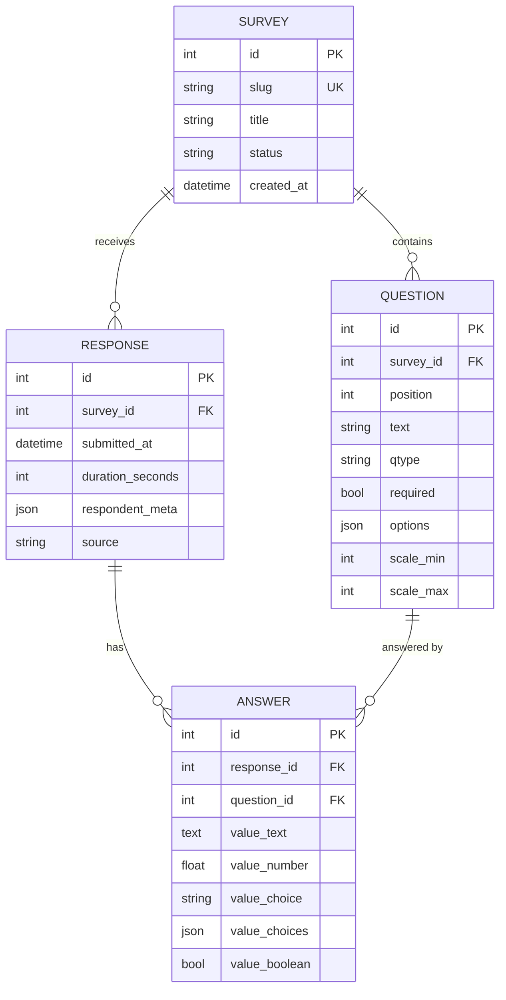

# Architecture

## Layering

```
presentation  ──  FastAPI routes            Streamlit pages
                       │                          │
                       └──────────┬───────────────┘
                                  ▼
services      ──  SurveyService · AnalyticsService · NLPService
                  InsightGenerator · ExportService · CSV importer
                                  ▼
repositories  ──  SurveyRepository · ResponseRepository
                                  ▼
models        ──  SQLAlchemy 2.0 ORM (Survey, Question, Response, Answer)
```

Each layer only imports the layer directly beneath it. That gives three practical
benefits:

1. **Testability** — services are exercised without HTTP or a browser.
2. **Single source of truth** — the API, dashboard, CLI and exporter all read the
   same `compute_survey_analytics` payload.
3. **Replaceability** — swapping SQLite for PostgreSQL, or the Streamlit UI for a
   React front-end, touches one layer.

## Data model



Answers use one typed column per value shape instead of a single JSON blob. That
keeps numeric aggregation in SQL possible (`AVG(value_number)`) while still
supporting multi-select answers.

Unique constraints:

- `surveys.slug` — shareable links stay stable.
- `(questions.survey_id, position)` — deterministic ordering.
- `(answers.response_id, question_id)` — one answer per question per response.

Foreign keys cascade on delete, and SQLite is configured with
`PRAGMA foreign_keys=ON` on every connection so the cascade actually applies.

## Request lifecycle

```
POST /api/v1/public/surveys/{slug}/responses
  │
  ├─ deps.db_session        opens a session, commits on success
  ├─ SurveyService.submit_response
  │    ├─ get_by_slug                    404 if unknown
  │    ├─ status check                   409 if not published
  │    ├─ _validate_answers
  │    │    ├─ unknown question ids      422
  │    │    ├─ required question missing 422
  │    │    ├─ scale bounds              422
  │    │    ├─ option membership         422
  │    │    └─ text length               422
  │    └─ ResponseRepository.add         inserts response + answers
  └─ 201 { id, survey_id, submitted_at, answers }
```

Domain exceptions carry an `status_code`, so the route never repeats HTTP logic —
one exception handler maps them to the error envelope.

## NLP pipeline

```
text ──► normalise (URLs, emails, whitespace)
      ──► tokenise ──► lexicon valence + negation window + intensifier
      ──► score = tanh(Σ valence / 2√hits) ∈ [-1, 1]
      ──► label POSITIVE / NEUTRAL / NEGATIVE  (threshold ±0.15)

corpus ──► TF-IDF (1-2 grams, sublinear) ──► K-Means over k = 2..min(max, √n)
        ──► silhouette score picks k
        ──► per-cluster mean TF-IDF = keywords

corpus ──► sentence split + dedupe ──► TF-IDF cosine graph
        ──► TextRank power iteration (damping 0.85)
        ──► greedy selection with 0.8 similarity cap = summary
```

The transformer backend swaps only the sentiment step; topics and summaries stay
identical, so switching backends does not silently change unrelated numbers.

## Caching

| Layer | Mechanism | TTL |
| --- | --- | --- |
| Sentiment | in-process LRU dict on normalised text | unbounded (bounded size) |
| Analytics payload | `st.cache_data` in the UI | 15 s |
| List/detail reads | `st.cache_data` | 15 s |
| Model singletons | `functools.lru_cache` | process lifetime |

Write operations call `invalidate()` which clears the Streamlit caches, so the UI
never shows stale counts after a submission.

## Failure behaviour

- **Database unavailable** → the API returns 500 from the ASGI server; `/health`
  stays independent of the DB so orchestrators can distinguish a dead process from
  a dead database.
- **NLP failure** → sentiment degrades to `NEUTRAL` rather than raising; analysis
  never blocks collection.
- **Empty datasets** → analytics returns zeroed structures with explicit `None`
  KPIs, never `NaN`, so JSON serialisation stays valid.
- **Export with no responses** → headers are still emitted, so downstream ETL jobs
  do not break on an empty file.
